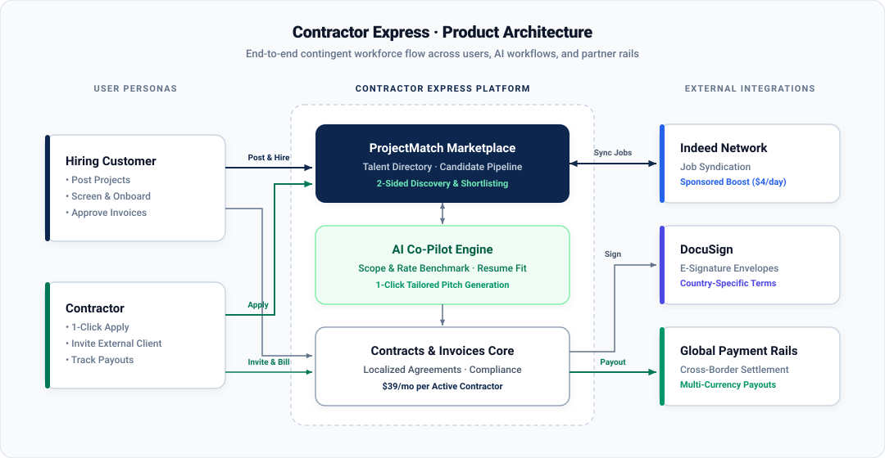

# Contractor Express — ProjectMatch (powered by Indeed)
*Interactive Product Prototype & Case Study* · **[Read the Full PRD (PRD.md)](./PRD.md)**

**ProjectMatch** is a product expansion concept for **Contractor Express** in partnership with **Indeed**. It connects contractor sourcing on Indeed with Contractor Express's localized DocuSign contracts and cross-border payouts so hiring teams and contractors can move from job post to active contract in one workflow.

---

## 1. Why build this? (Summary)

Global contractor management platforms face two structural bottlenecks:
1. **Late entry in the hiring funnel:** Companies only log into Contractor Express *after* spending weeks sourcing and vetting freelancers on external job boards.
2. **Seat churn when projects end:** Contractor projects typically last 2–6 months. When a project ends, the contract terminates—and both the customer's seat revenue ($39/mo per active contractor) and the contractor's platform activity drop to zero.

**How ProjectMatch solves this:**
- **Core seat expansion ($39/mo per active contractor):** Candidates hired through ProjectMatch convert directly into active Contractor Express seats.
- **Marketplace ad revenue (Indeed Sponsored Boost):** Customers can boost project visibility on Indeed from the posting flow at a **$4/day** partner rate (20% off the $5/day standard rate).
- **Contractor-led client acquisition (`Invite Client`):** Pre-verified contractors can invite external clients they found elsewhere to sign and pay on Contractor Express.

*(See **[PRD.md](./PRD.md)** for full user stories, functional requirements, KPI hypotheses, and risk mitigations.)*

### Product architecture overview



---

## 2. What to test in the live prototype

Use the **Persona Preview** toggle in the left sidebar to switch between both sides of the marketplace:

### A. Customer workspace (*Lumina Global Services*)
- **Home dashboard:** View active contractor spend, pending ProjectMatch applicants across open roles, and invoices awaiting approval.
- **Post project to Indeed:** Draft a project brief or click **AI Project Brief & Rate Benchmarker** to generate a role scope, required skills, and USD hourly rate range across 6 industries (*Technology, Healthcare, Construction, Retail, Marketing, Finance*).
- **Candidate pipeline and screening:**
  - Move applicants across stages (`New` → `Interviewing` → `Contract Sent via DocuSign` → `Onboarded` / `Rejected` / `Terminated`).
  - Run **AI Resume Fit Analysis** on any candidate card to generate a 0–100% match score, key strengths, and interview questions to probe.
  - Browse the **Indeed Talent Directory** to invite pre-vetted global contractors to open projects.
- **DocuSign contract dispatch and 1-click onboarding:** Generate a country-specific contractor agreement, send it via DocuSign, and complete onboarding to activate the contractor in the **Contracts** tab.
- **Invoices and payout approval:** Review submitted hours and approve cross-border payouts.

### B. Contractor workspace (*Mateusz Kowalski — Warsaw, Poland*)
- **Contractor home dashboard:** Track active client contracts, submitted ProjectMatch applications, and pending invoice payouts.
- **Find projects (powered by Indeed):**
  - Filter remote contract openings by industry and search keywords.
  - Use the **1-Click AI Tailored Pitch** generator to draft an application note and recommended hourly rate matched to the client's budget and the contractor's work history.
  - Preview the verified **Contractor Express Resume** shared with hiring companies.
- **Invite external client:** Send a pre-filled contract invitation to an external client to onboard and pay via Contractor Express.

---

## 3. Prototype status and known limitations

- **In-memory state:** All profiles, contracts, and invoices use sample data stored in browser memory. Actions taken in the Customer workspace immediately update the Contractor workspace during your session, and reset to the initial demo state when you refresh the browser.
- **Simulated partner integrations:** Indeed job syndication, DocuSign envelope generation, and cross-border payouts are simulated UI flows to demonstrate the end-to-end product experience.
- **Zero-config AI features:** When hosted on GitHub Pages, the AI buttons use built-in client-side fallbacks so every flow works reliably without requiring an external API key or backend server.

---

## 4. Running locally (optional)

You can use the live **GitHub Pages link** directly in your browser. If you want to run the code locally on your machine:

1. **Install dependencies:**
   ```bash
   npm install
   ```
2. **Start the local Vite server:**
   ```bash
   npx vite --port 3000
   ```
3. **Open in your browser:**
   Navigate to **`http://localhost:3000`**
